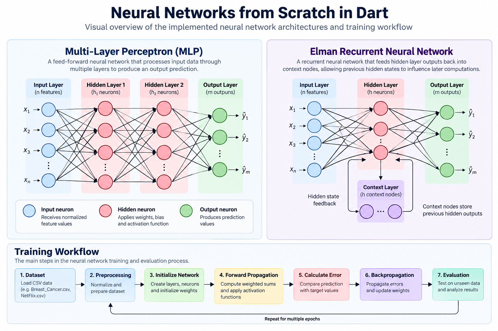

# Neural Networks from Scratch in Dart

A from-scratch implementation of neural networks in **Dart**, created as an educational project to explore the internal mechanics of feed-forward neural networks, backpropagation, recurrent connections, dataset preparation, training, evaluation, and model-weight persistence.

The project includes implementations of:

- Multi-Layer Perceptron (MLP)
- Elman recurrent neural network
- Manual forward propagation
- Manual backpropagation
- Manual weight updates
- Activation functions
- Dataset preprocessing
- Training and evaluation
- Weight serialization and loading

No machine-learning framework is used for the neural-network implementation.

---

## 🎯 Project Goal

The purpose of this project is to understand how neural networks work internally by implementing their main components manually rather than relying on high-level machine-learning libraries.

The project explores concepts such as:

- Neurons and layers
- Weighted connections
- Bias values
- Activation functions
- Forward propagation
- Error calculation
- Backpropagation
- Gradient-based weight updates
- Recurrent context
- Dataset normalization
- Training and testing
- Saving and loading trained weights

The main focus is educational clarity rather than production-level machine-learning performance.

---

## 🖼️ Architecture Overview

<p align="center">
  
</p>

The diagram summarizes the two implemented neural-network architectures and the overall training workflow used in the project.

---

## 🧠 Implemented Networks

### Multi-Layer Perceptron

The MLP implementation supports a traditional feed-forward neural-network workflow.

The training process includes:

1. Feeding input values into the network
2. Computing weighted sums
3. Applying activation functions
4. Producing output predictions
5. Calculating prediction error
6. Propagating errors backward through the network
7. Updating weights
8. Repeating the process across training epochs

The implementation is written manually in Dart so that the internal learning process remains visible.

---

### Elman Recurrent Neural Network

The project also includes an implementation of an **Elman-style recurrent neural network**.

The recurrent network feeds hidden-layer outputs back into context/input nodes across a time window, allowing previous hidden-state information to influence later computations.

This implementation is educational and intentionally preserves the original project behavior.

It does not attempt to replace the implementation with modern recurrent-learning frameworks or abstractions.

---

## ⚙️ Activation Functions

The project includes manually implemented activation-function support, including:

- Sigmoid
- ReLU

Activation behavior is handled inside the custom neural-network implementation rather than through an external ML framework.

---

## 🔄 Training Workflow

At a high level, the neural-network workflow is:

```text
Dataset
   │
   ▼
Preprocessing / Normalization
   │
   ▼
Network Initialization
   │
   ▼
Forward Propagation
   │
   ▼
Prediction
   │
   ▼
Error Calculation
   │
   ▼
Backpropagation
   │
   ▼
Weight Updates
   │
   ▼
Evaluation
```

For the Elman implementation, recurrent context is also incorporated into the input flow.

---

## 📊 Datasets

The repository includes example datasets used by the original project experiments.

```text
data/
├── Breast_Cancer.csv
└── NetFlix.csv
```

The datasets are used to demonstrate:

- CSV loading
- Data preprocessing
- Normalization
- Training
- Testing
- Prediction/evaluation

Dataset contents were preserved during the repository refactor.

---

## 💾 Model Weights & Prepared Data

The project supports saving and loading generated neural-network artifacts.

Saved model weights are stored under:

```text
artifacts/weights/
```

Prepared datasets are stored under:

```text
artifacts/prepared_datasets/
```

The original `.mnb` serialization format and artifact filenames were preserved during the refactor.

This makes it possible to reuse previously generated artifacts without changing the original serialization behavior.

---

## 🏗️ Project Structure

```text
neural-networks-from-scratch-dart/
├── bin/
│   ├── mlp_example.dart
│   └── elman_example.dart
│
├── lib/
│   ├── neural_network/
│   │   ├── activation_functions.dart
│   │   ├── neuron.dart
│   │   ├── layer.dart
│   │   ├── mlp.dart
│   │   └── elman.dart
│   │
│   └── data/
│       ├── dataset_utils.dart
│       └── dictionary.dart
│
├── data/
│   ├── Breast_Cancer.csv
│   └── NetFlix.csv
│
├── artifacts/
│   ├── weights/
│   └── prepared_datasets/
│
├── docs/
│   ├── images/
│   │   └── neural-networks-overview.png
│   ├── Backpropagation .docx
│   ├── Elman.docx
│   └── NN_Report_template.docx
│
├── main.dart
├── pubspec.yaml
├── README.md
├── REFACTOR_NOTES.md
└── .gitignore
```

The root `main.dart` remains as a compatibility entry point for the MLP example.

---

## 🧩 Main Components

### `activation_functions.dart`

Contains activation-function logic used by the neural networks.

---

### `neuron.dart`

Represents individual neural-network neurons and their related values and connections.

---

### `layer.dart`

Contains the layer representation used by the network implementations.

---

### `mlp.dart`

Contains the Multi-Layer Perceptron implementation, including:

- Network initialization
- Forward propagation
- Backpropagation
- Training
- Evaluation
- Weight persistence

---

### `elman.dart`

Contains the Elman recurrent-network implementation, including recurrent context handling and training/evaluation logic.

---

### `dataset_utils.dart`

Contains dataset-related utilities such as:

- Dataset preparation
- Dataset serialization
- Dataset loading
- Experiment preprocessing helpers

---

### `dictionary.dart`

Contains dictionary/data-mapping and normalization-related functionality used by the example datasets.

---

## 🚀 Getting Started

### 1. Clone the Repository

```bash
git clone https://github.com/Mahmoudmnb/neural-networks-from-scratch-dart.git
cd neural-networks-from-scratch-dart
```

### 2. Install Dependencies

```bash
dart pub get
```

---

## ▶️ Running the Examples

### Multi-Layer Perceptron

Run:

```bash
dart run bin/mlp_example.dart
```

The root compatibility entry point can also be used:

```bash
dart run main.dart
```

> The MLP experiment may generate or update saved weight artifacts depending on the active training configuration.

---

### Elman Network

Run:

```bash
dart run bin/elman_example.dart
```

The Elman example performs its original recurrent-network experiment using the preserved project logic.

---

## 🧪 Code Quality

The project was refactored to improve:

- Directory organization
- File naming
- Dart naming consistency
- Source-code readability
- Documentation
- Separation between MLP and Elman examples
- Dataset organization
- Artifact organization
- Import structure

The refactor was intentionally behavior-preserving.

The following were not intentionally changed:

- Network architecture
- Forward propagation
- Backpropagation
- Weight-update formulas
- Activation behavior
- Dataset contents
- Weight serialization format
- Prepared dataset serialization format

For detailed information about the refactor, see:

```text
REFACTOR_NOTES.md
```

---

## ✅ Validation

The refactored project was validated with:

```bash
dart format .
dart pub get
dart analyze
```

`dart analyze` completed successfully with no reported issues.

The Elman example was also executed successfully after the refactor.

Automated tests are not currently included in the repository.

---

## ⚠️ Educational / Experimental Notes

This is an educational implementation and intentionally preserves several behaviors from the original project.

Some areas may differ from how modern production neural-network frameworks implement the same concepts.

Examples include:

- The Elman implementation uses a simplified recurrent training flow rather than full backpropagation through time.
- Some activation-derivative behavior reflects the original implementation.
- Dataset shuffling is not currently deterministic.
- Dataset normalization occurs before the train/test split in the original workflow.
- Some evaluation logic is intentionally preserved even where it could be improved.

These behaviors were documented rather than silently changed so that the repository continues to represent the original implementation accurately.

---

## 🔮 Possible Future Improvements

Potential future improvements include:

- Deterministic dataset shuffling
- Train-only normalization statistics
- More robust activation derivative handling
- Full backpropagation through time for recurrent networks
- Improved evaluation metrics
- Command-line configuration for experiments
- Automated unit tests
- Forward-pass verification tests
- Weight serialization tests
- Dataset serialization tests
- Additional activation functions
- Better experiment configuration

These improvements should be introduced carefully so the educational implementation remains easy to understand.

---

## 🎓 Academic Context

This project was developed as an educational neural-network project focused on understanding artificial neural networks by implementing their fundamental operations manually.

Rather than using a ready-made machine-learning framework, the project exposes the internal steps involved in:

- Network construction
- Neuron communication
- Activation functions
- Forward propagation
- Backpropagation
- Recurrent context
- Training
- Evaluation
- Weight persistence

---

## 🛠️ Tech Stack

- Dart
- Custom neural-network implementation
- CSV dataset processing
- Manual backpropagation
- Manual weight updates
- MLP
- Elman recurrent network

---

## 📌 Project Status

**Academic / educational project**

The repository is intended primarily as a demonstration of neural-network fundamentals implemented manually in Dart.

It is not intended to replace modern machine-learning frameworks for production workloads.

---

## 👨‍💻 Author

**Mahmoud Bannan**

Flutter Developer & Audio AI Engineer

- GitHub: [@Mahmoudmnb](https://github.com/Mahmoudmnb)
- Portfolio: [mahmoudbannan.com](https://mahmoudbannan.com)

---

## 📄 License

This repository is provided for educational and portfolio purposes.

If a dedicated `LICENSE` file is added, its terms take precedence over this notice.